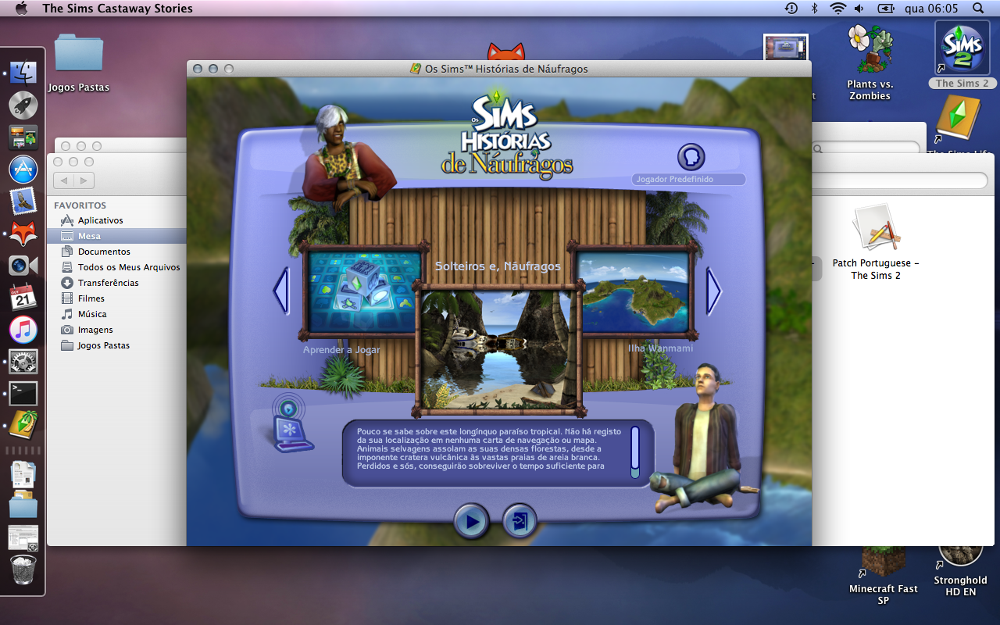

# The sims Naufragos Patch Portugues Mac Version

Iniciador compartilhável para o **The Sims Castaway Stories (Náufragos)** para
Mac OS X. O iniciador pede ao aplicativo do jogo para carregar o idioma
`Portuguese` sem substituir o aplicativo original, sem alterar arquivos do
sistema e sem incluir arquivos do jogo.

> Compatibilidade validada experimentalmente em um MacBook2,1 com Mac OS X Lion
> 10.7. O comportamento pode variar conforme a edição do jogo e os recursos de
> idioma instalados.

## Demonstração

Captura real do The Sims Castaway Stories funcionando em português:



## O que este projeto faz

- instala um aplicativo separado chamado **Patch Portuguese - The Sims Naufragos**;
- abre o `The Sims Castaway Stories.app` com o argumento `-l:Portuguese`;
- permite iniciar manualmente pelo Terminal, sem instalar o app;
- mantém o jogo original intacto;
- funciona com instalações que já contenham os recursos de idioma em português.

O parâmetro foi testado na instalação usada no desenvolvimento. Se a instalação
de outra pessoa não tiver os recursos portugueses, o iniciador não consegue
criar a tradução sozinho e o jogo pode continuar em inglês.

## Instalação no Mac

### 1. Requisitos

- The Sims Castaway Stories para Mac instalado;
- Mac OS X 10.7 ou posterior;
- acesso ao Terminal apenas para a instalação inicial.

### 2. Baixar o projeto

No Terminal:

```sh
git clone https://github.com/RafJaeger/The-Sims-Naufragos-Patch-Portugues-Mac-Version.git
cd The-Sims-Naufragos-Patch-Portugues-Mac-Version
```

### 3. Instalar o iniciador na Mesa

```sh
sh macos/install.sh
```

Por padrão, ele instala somente o iniciador em:

```text
~/Desktop/Patch Portuguese - The Sims Naufragos.app
```

Depois, abra pelo Finder ou pelo Terminal:

```sh
open "$HOME/Desktop/Patch Portuguese - The Sims Naufragos.app"
```

### 4. Testar diretamente pelo Terminal

Sem instalar o iniciador, o jogo pode ser aberto assim:

```sh
open "/Applications/The Sims Castaway Stories.localized/The Sims Castaway Stories.app" --args "-l:Portuguese"
```

### 5. Se o jogo estiver em outro local

```sh
PATCH_PORTUGUESE_CASTAWAY_PATH="/caminho/The Sims Castaway Stories.app" \
  open "$HOME/Desktop/Patch Portuguese - The Sims Naufragos.app"
```

## Instalação em `/Applications`

Se o usuário preferir deixar o iniciador junto dos outros aplicativos:

```sh
PATCH_PORTUGUESE_DEST="/Applications/Patch Portuguese - The Sims Naufragos.app" \
  sh macos/install.sh
```

## Como desfazer

Apague apenas o iniciador instalado. O jogo original não é modificado:

```sh
rm -rf "$HOME/Desktop/Patch Portuguese - The Sims Naufragos.app"
```

## Observações

Este repositório contém apenas código de inicialização, o ícone e documentação.
Cada usuário deve fornecer sua própria cópia do jogo e seus próprios recursos
de idioma. O projeto não promete compatibilidade universal com todas as
edições ou instaladores.
